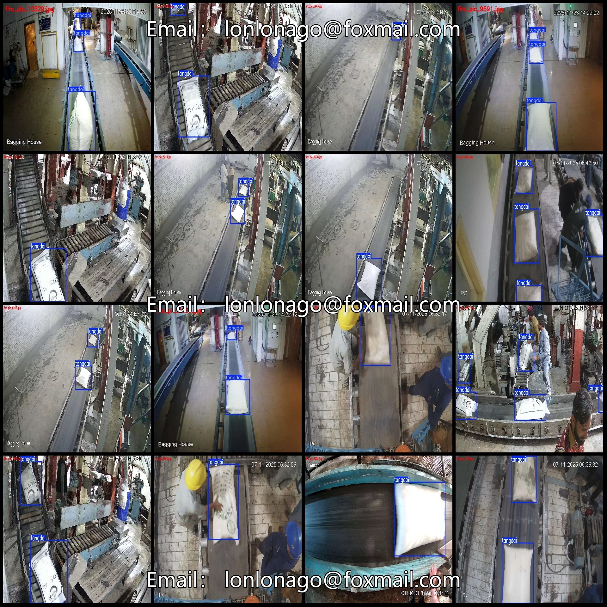
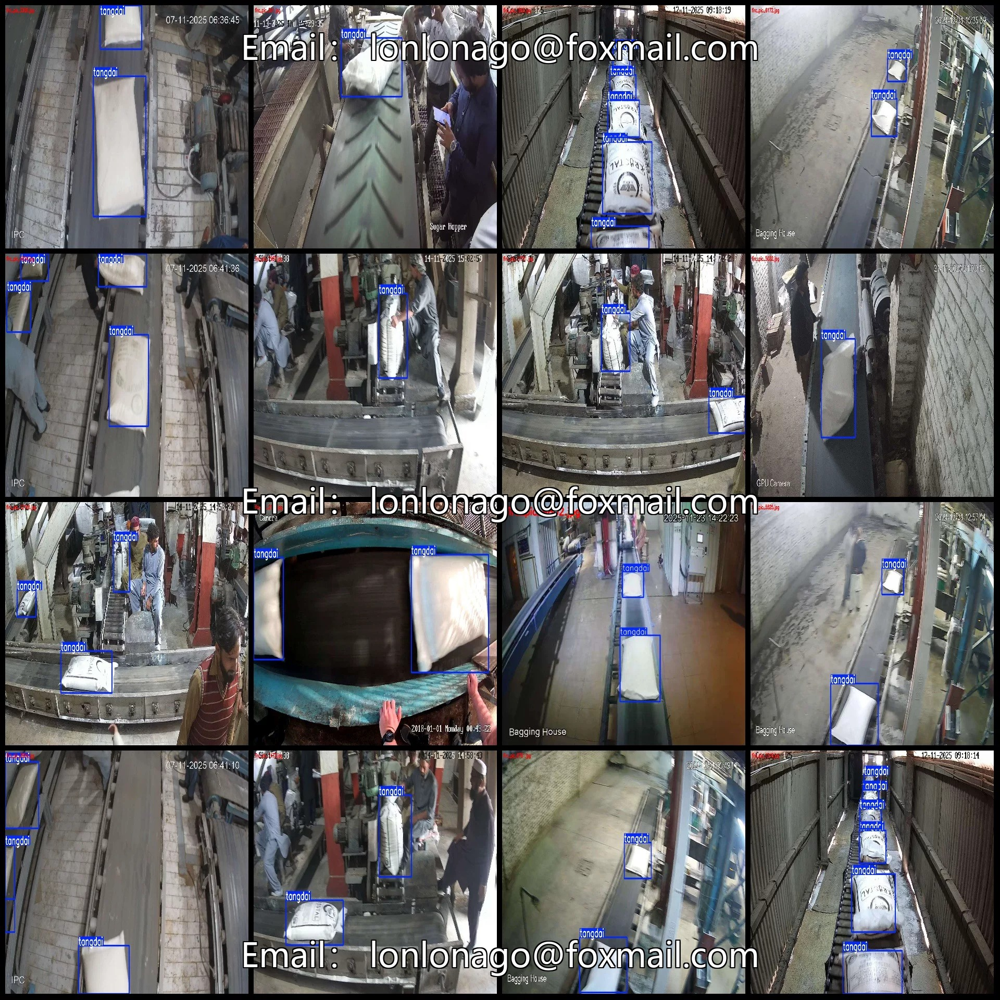
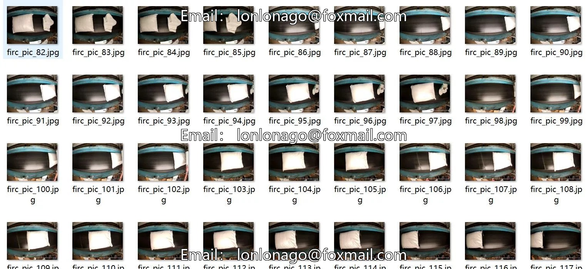
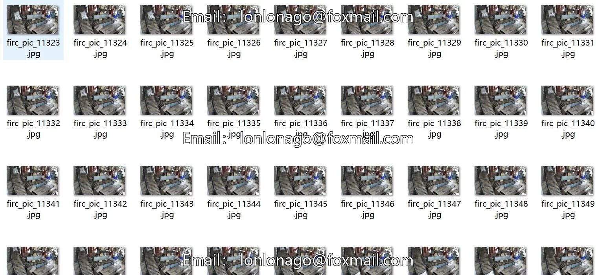
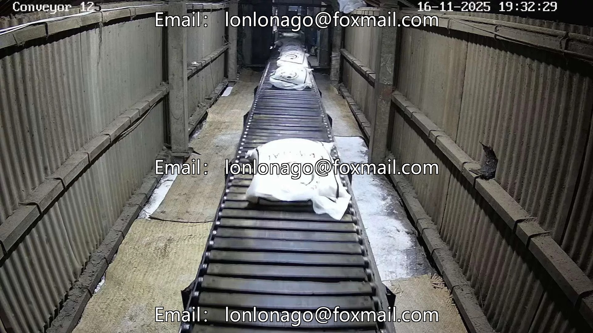

# Industrial workshop assembly line bag counting detection dataset VOC+YOLO format 129

## Body

Industrial workshop assembly line bag counting detection dataset VOC+YOLO format 12943 categories
Warm Reminder: Due to the dataset's replicability, please confirm compliance with requirements before purchasing.
Please note that images are extracted from video frames for specific analysis.
Dataset format: Pascal VOC format + YOLO format (txt file without split path, only containing jpg images along with corresponding VOC format xml files and yolo format txt files)
Number of images (jpg file count): 12943
Number of annotations (xml file count): 12943
Number of annotations (txt file count): 12943
Number of annotation categories: 1
Annotation category name: ["tangdai"]

Number of boxes per category
Tangdai box count = 29712
Total number of boxes: 29712
Number of images per category
Tangdai image count = 12943
Image resolution: Multi-resolution images, such as 1920x1080, 1920x1079, etc.
Labeling tool used: labelImg
Labeling rules: Draw a rectangle around the category.
Important note: The dataset does not have separate training, validation, and test sets; you need to partition them yourself.
Special declaration: This dataset does not guarantee the accuracy of the trained models or weight files.

## Images

## Payment

Here is a pay link on Stripe ( https://buy.stripe.com/3cs8yP7sY87d0vu9AB ). Please contact me lonlonago@foxmail.com after funding $89, and I will send you a complete data files , thank you!

